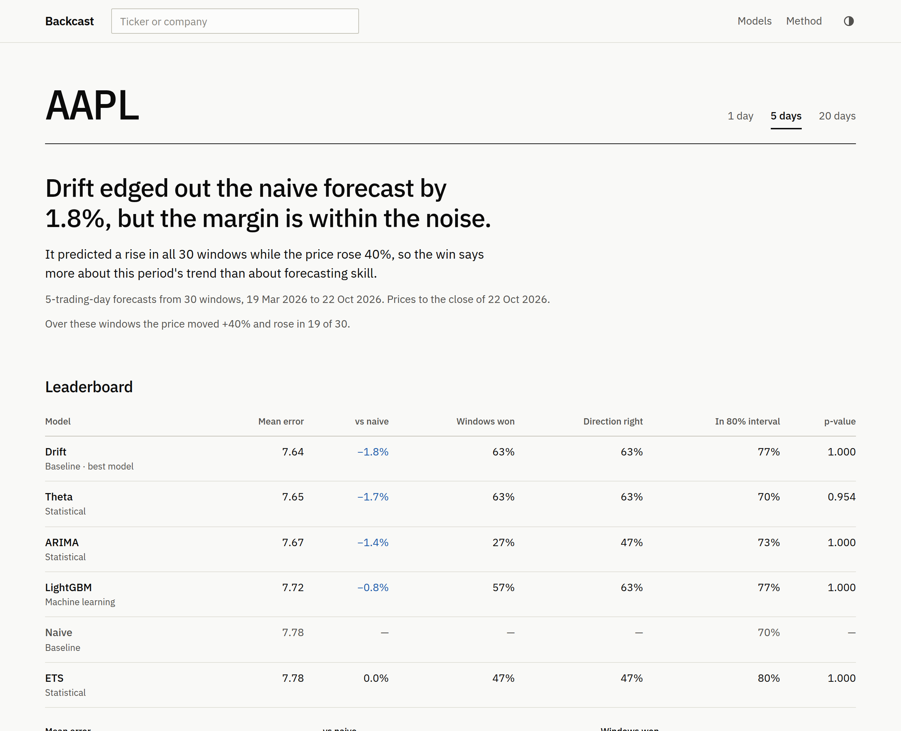
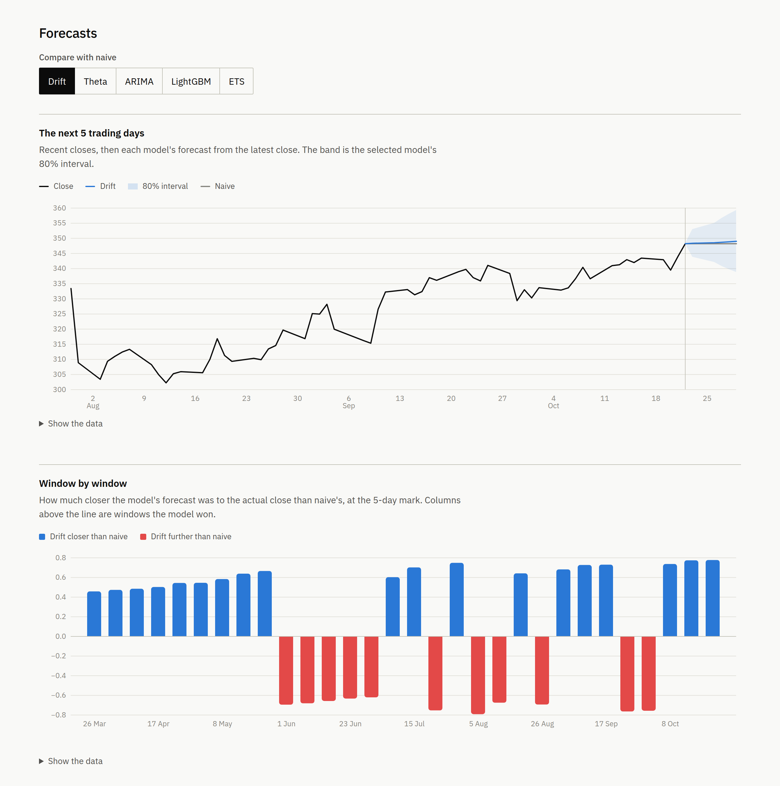

# Backcast

[](https://github.com/adeelbandesha/backcast/actions/workflows/ci.yml)

Backcast checks whether any forecasting model could have predicted a stock's price better than the laziest guess
there is: that the price a few days from now will be the same as it is today.

Most of the time the answer is no. Daily stock prices behave a lot like a random walk, and against a random walk the
naive forecast is very hard to beat. Plenty of stock prediction demos never check this. They draw the model's
predictions over the real price, the two lines look close, and that gets taken as proof the model works. A forecast
that just copies yesterday's price would look every bit as close. Backcast scores each model against that copy,
only on prices the model hadn't seen, and then tests whether the difference is bigger than luck.



## How it works

You give it a ticker and a horizon of 1, 5 or 20 trading days. Backcast then:

1. downloads five years of daily closes from Yahoo Finance (or [another source](#price-data)), adjusted for splits
   but not for dividends, and leaves out today's price if the market hasn't closed yet;
2. makes a forecast from every one of the last 504 trading days (about two years), each model seeing only the
   prices up to that day and forecasting the close `h` trading days later. Models are re-estimated every 20 trading
   days and keep their parameters in between, while still seeing each new close;
3. compares each forecast with the price that actually came, on log prices so a 2% miss counts the same at any
   price level, and scores it.

| Column (CLI name)                             | What it measures                                                                         |
| --------------------------------------------- | ---------------------------------------------------------------------------------------- |
| Mean error (`mae_pct`)                        | Average absolute gap between the log forecast and the log close. Reads as a percentage.  |
| vs naive (`relative_mae`)                     | Mean error relative to naive's. The leaderboard is sorted by it, and lower is better.    |
| CRPS vs naive (`relative_crps`)               | Scores the whole forecast distribution (nine quantiles), relative to naive's.            |
| Interval score vs naive (`relative_interval`) | Width of the 80% interval plus a heavy charge for every close outside it, vs naive's.    |
| Days won (`win_rate`, `tie_rate`)             | Share of the 504 forecasts in which the model was closer than naive, and share tied.     |
| Direction right (`direction`)                 | How often the forecast moved the same way as the price. Forecasts of no change left out. |
| In 80% interval (`coverage`)                  | How often the actual close fell inside the model's 80% interval.                         |
| p-value (`p_adjusted`)                        | Diebold-Mariano test against naive, Holm-adjusted for testing five models.               |

Forecasts made a day apart share most of their future, so their errors are correlated and a plain t-test finds
edges that aren't there. In a simulation with no real edge it called 20-day results significant two times out of
three. The Diebold-Mariano test allows for the overlap and was wrong 5 to 7% of the time at the 5% level.

The headline uses a different test. Picking the best of five models and testing it alone overstates the evidence,
so the verdict comes from Hansen's test for superior predictive ability (SPA), which bootstraps all five models
together and asks whether the best of them beats naive by more than luck would. Results are also split by whether
the stock was above or below its 200-day average on the forecast date, and when the best model won by betting the
same direction nearly every day of a period that trended that way, the verdict says so. The Method page in the web
app goes through all of this in more detail.

## Getting started

You need [uv](https://docs.astral.sh/uv/). It will download Python 3.13 if you don't have it.

```bash
uv sync
uv run backcast run SPY --horizon 5
```

If you'd rather use pip, any Python 3.13 environment works. `requirements.txt` pins the same versions as `uv.lock`:

```bash
pip install -r requirements.txt
pip install -e .
backcast run SPY --horizon 5
```

A backtest needs roughly 40 to 80 seconds of CPU time, spread across every core, so a four-core machine finishes
in 10 to 20 seconds. Everything runs on the CPU; a GPU isn't used and doesn't help. This is a real run from
23 October 2026:

```
SPY: 5-day forecasts from 504 trading days

Drift edged out the naive forecast by 1.2%, but the margin is within the noise. It predicted a rise on all 504 days while the price rose 30%, so the win says more about this period's trend than about forecasting skill.
SPA p-value that no model beats naive: 0.268

   model  mae_pct  relative_mae  relative_crps  relative_interval  win_rate  tie_rate  p_value  direction  coverage  p_adjusted
   Drift    1.504         0.988          0.995              0.996     0.560     0.000    0.231      0.575     0.895       0.925
   Theta    1.506         0.990          1.005              0.983     0.563     0.000    0.126      0.575     0.889       0.630
   Naive    1.521         1.000          1.000              1.000         —         —        —          —     0.899           —
     ETS    1.522         1.000          1.000              1.001     0.522     0.000    0.383      0.522     0.901       0.925
   ARIMA    1.526         1.003          1.002              1.006     0.131     0.722    0.500      0.515     0.899       0.925
LightGBM    1.549         1.018          0.982              0.906     0.478     0.000    0.276      0.522     0.728       0.925
```

Drift came out on top by predicting a rise on every one of the 504 days while SPY climbed 30%. No model's edge
survives the tests. The best Diebold-Mariano p-value is Theta's 0.126, and that is before adjusting for five tries.
If none of the models were better than naive, a best result this good would still turn up about 27% of the time
(the SPA p-value). ARIMA tied naive on 72% of days: it usually settles on a random walk.

The intervals are worth a look too. Most models' 80% intervals held the actual close about 90% of the time, so
they were too wide. Daily returns have fat tails: a few very large days inflate the volatility the intervals are
built from, which leaves them wider than a typical week needs. LightGBM's quantile regression has the opposite
problem at 73%, yet it has the best interval score: its narrower intervals saved more than its extra misses cost.

## The web app

```bash
uv run backcast web
```

This starts the site and a worker beside it. Open http://127.0.0.1:8000 and search for a company or ticker. The
backtest runs in the worker while the page shows where it is in the queue, and the results appear when it's done.

Every finished run is saved and has its own address, `/runs/<id>/`, which keeps showing that run. The id is a
fingerprint of the prices, the settings and the Backcast version, so asking for the same backtest on the same data
goes straight to the saved run, and new prices make a new one. The page records the date of the last close, the
price source, the version and the settings it ran with.

Each backtest page has the verdict, the leaderboard, the same comparison split into up and down markets, a chart
of the next few trading days as each model sees them, and a running total of how far the chosen model has pulled
ahead of naive, or fallen behind, over the two years. Every chart has a table of the numbers behind it.



## The models

| Model    | Kind             | Notes                                                                                          |
| -------- | ---------------- | ---------------------------------------------------------------------------------------------- |
| Naive    | Baseline         | Tomorrow's price is today's. The benchmark.                                                    |
| Drift    | Baseline         | Naive plus the average daily percentage change over the training data.                         |
| ETS      | Statistical      | Exponential smoothing, components picked automatically.                                        |
| ARIMA    | Statistical      | Auto-ARIMA.                                                                                    |
| Theta    | Statistical      | The Theta method, which did well in the M3 competition.                                        |
| LightGBM | Machine learning | Gradient-boosted trees on the last 20 daily log returns, quantile regression for the interval. |

ETS, ARIMA and Theta come from [statsforecast](https://github.com/Nixtla/statsforecast). Every model is fitted to
log prices and its forecasts converted back, so none can forecast a price below zero, and each one's point forecast
is the median of its distribution.

To add a model, subclass `Model` in `src/backcast/models.py`, implement `forecast(y, h)` so it returns a `Forecast`
with a median path of length `h` and its quantiles from 10% to 90% (an array of shape `(9, h)`), and append an
instance to `MODELS`. Forecasts must be positive prices with the quantiles in increasing order, or the backtest
stops with an error; the built-in models work on log prices, which guarantees both. If estimating is slow,
implement `fit(y, h)` instead: it returns a function that forecasts from any later history with the same
estimates, and the backtest calls it between refits. The CLI, the leaderboard and the charts will include it.
Forecasts run in worker processes, so the model has to be picklable. Defining the class at module level is
enough.

## Price data

Prices come from Yahoo Finance by default, with no account or key needed. `BACKCAST_PRICE_SOURCE` switches the
command line and the web app to another source, named or given as a module path:

```bash
BACKCAST_PRICE_SOURCE=csv BACKCAST_CSV_DIR=~/prices uv run backcast run AAPL
BACKCAST_PRICE_SOURCE=mysources.feed uv run backcast web
```

Backcast ships two sources, `yahoo` and `csv`, and doesn't include any paid data provider. If you have a licence for
one, you can add it yourself (see below), either as a module or as a package that anyone can install.

**CSV files.** One file per symbol, named after it (`AAPL.csv`), with a `Date` and a `Close` column. Other columns are
ignored, so a standard export works as it is. Use closes adjusted for splits but not for dividends, and never an
Adj Close column. Set `BACKCAST_CSV_CALENDAR` to an
[exchange_calendars](https://github.com/gerrymanoim/exchange_calendars) code such as `XNYS` and future dates skip
that exchange's holidays; otherwise they skip weekends only.

**Your own provider.** Any importable module that defines `load_prices(symbol, years)`, returning a pandas Series of
closes indexed by date, split-adjusted and not dividend-adjusted, finished trading days only. Set
`close.attrs["calendar"]` if you know the exchange. Raise `backcast.data.DataError` with a readable message when a
symbol can't be loaded. Two optional names: `search_symbols(query, limit)`, returning dicts with `symbol`, `name` and
`exchange` for the web app's search box, and `ATTRIBUTION`, a sentence for the footer.

**A provider package.** To share a source, or keep several installed side by side, put the module in its own
package and register it under the `backcast.price_sources` entry point group. Backcast registers `yahoo` and `csv`
the same way. In the package's `pyproject.toml`:

```toml
[project.entry-points."backcast.price_sources"]
polygon = "backcast_polygon.source"
```

After `pip install backcast-polygon`, `BACKCAST_PRICE_SOURCE=polygon` selects it. Read API keys from environment
variables in your module, never from Backcast's settings. Saved runs record the source's name, so results from
different providers never mix.

Whatever the source, Backcast checks the prices before a backtest sees them: one positive close per date, sorted,
trimmed to the same five years. Problems are reported with the date they occur on. A source that can't be imported
stops the command line with an explanation and stops the web app at startup.

## Project layout

```
src/backcast/
  data.py        loads and checks prices from the configured source; trading calendars
  sources/       the built-in price sources: Yahoo Finance and CSV files
  models.py      the forecasting models
  evaluate.py    walk-forward backtest, metrics, significance tests, the verdict
  study.py       the S&P 500 study's placebo and dataset rows
  version.py     the version recorded with every run
  cli.py         the backcast command
  web/           Django app: views, templates, CSS, and the charts (Observable Plot)
    tasks.py     the background jobs: running and saving a backtest, and the nightly examples
    models.py    the saved run
tests/           engine, data, price source, study and view tests; none of them touch the network
scripts/         refit_check.py, the experiment behind the refit interval; study.py, the S&P 500 study
```

## Deploying

The web app is a small Django project with no user accounts. It needs two processes: the site, run with Gunicorn,
and a worker that runs the backtests.

The simplest way to run both is Docker Compose, which also keeps the saved runs in a Docker volume:

```bash
BACKCAST_COMMIT=$(git describe --always --dirty) docker compose up --build
```

The site is then at http://127.0.0.1:8000, reachable only from this machine. The image refuses to build without
`BACKCAST_COMMIT`, for the reason given below. A one-off `migrate` service sets up the database before the site and
the worker start, so they never both try. To use another price source, set `BACKCAST_PRICE_SOURCE` the same way; a
provider package has to be installed in the image first.

Without Docker:

```bash
export BACKCAST_SECRET_KEY=... BACKCAST_ALLOWED_HOSTS=backcast.example.com BACKCAST_DATA_DIR=/var/lib/backcast
uv run backcast worker &      # creates or updates the database, then waits for jobs
uv run gunicorn --timeout 120 backcast.web.wsgi
```

The job queue is [Huey](https://huey.readthedocs.io/) on a SQLite file, and saved runs are in a second SQLite file,
so there's no Redis or database server to run. Both live in `BACKCAST_DATA_DIR`, which the site and the worker must
share and which should be backed up if you want old run links to keep working.

Settings come from environment variables:

| Variable                    | Default                          | What it's for                                            |
| --------------------------- | -------------------------------- | -------------------------------------------------------- |
| `BACKCAST_SECRET_KEY`       | an insecure development key      | Django's secret key. Set it in production.               |
| `BACKCAST_ALLOWED_HOSTS`    | `localhost,127.0.0.1`            | Comma-separated host names.                              |
| `BACKCAST_DEBUG`            | off                              | Set to `1` for Django's debug pages.                     |
| `BACKCAST_DATA_DIR`         | `~/.backcast`                    | Saved runs and the job queue (two SQLite files).         |
| `BACKCAST_CACHE_DIR`        | `backcast-cache` in the temp dir | Where prices, searches and rate limits are cached.       |
| `BACKCAST_COMMIT`           | from git, in a source checkout   | The commit to record with each run. Set it in an image.  |
| `BACKCAST_STATIC_ROOT`      | unset                            | Only needed if you run `collectstatic`.                  |
| `BACKCAST_RUNS_PER_HOUR`    | `30`                             | New backtests one visitor may start per hour.            |
| `BACKCAST_CLIENT_IP_HEADER` | unset                            | Header your reverse proxy puts the visitor's address in. |
| `BACKCAST_LOG_LEVEL`        | `INFO`                           |                                                          |
| `BACKCAST_PRICE_SOURCE`     | `yahoo`                          | `yahoo`, `csv`, or your own module. See Price data.      |
| `BACKCAST_CSV_DIR`          | unset                            | The folder of price files for the `csv` source.          |
| `BACKCAST_CSV_CALENDAR`     | unset                            | Trading calendar for CSV prices, such as `XNYS`.         |

The backtest page loads prices inside the request, and when Yahoo is slow that can take most of a minute, so
the example raises Gunicorn's 30-second timeout. Prices are cached on disk for an hour, and every Gunicorn worker
reads the same cache. WhiteNoise serves the static files directly from the package, so `collectstatic` is
optional.

The worker runs one backtest at a time, because each one already spreads across every core. Others wait in the
queue. Runs the site finds already saved cost nothing. A run left unfinished for 15 minutes, say because the worker
restarted, is started again the next time someone asks for it.

The version recorded with each run, and used in its id, is the package version plus the git commit when Backcast
runs from a checkout. Outside a checkout, such as in a container image, set `BACKCAST_COMMIT`; otherwise a new
release of the code with the same version number would find the old saved runs and show them.

Every weekday at 22:30 UTC, after the US close, the worker runs the six examples on the home page (AAPL, MSFT,
NVDA, SPY, KO and TSLA) at all three horizons, so they open straight away.

Because a new run keeps every core busy, each visitor can start only a limited number per hour; saved runs don't
count. Behind a reverse proxy, set `BACKCAST_CLIENT_IP_HEADER` (for example `X-Forwarded-For`), or
every visitor appears to come from the proxy and they all share one limit. Only set it if the proxy overwrites
that header, since anyone can send it.

## Limits

Read the results with these in mind:

- Two years is one stretch of market history. A result can hold over these two years and not the next two.
- A stock needs about two and a half years of history before it can be tested: 500 days before the first forecast
  and at least 100 forecasts after it.
- Only the price history goes in. There's no volume, no fundamentals, no news.
- Errors are measured on prices, not on trading returns. A model that beats naive here could still lose money once
  you add costs.
- Dividends aren't added back. On the day a stock goes ex-dividend its price drops by about the dividend, and none
  of the models forecast that.
- Future dates follow the exchange's holiday calendar for most major exchanges. For the rest, they skip weekends
  only.
- By default, prices come through [yfinance](https://github.com/ranaroussi/yfinance), an unofficial Yahoo Finance
  client, and Yahoo's terms apply to the data.

None of this is investment advice.

## The S&P 500 study

One backtest says little: a stock where some model beats naive could just be lucky. The study runs the same
backtest on every current S&P 500 member at every horizon and counts how often a model wins by more than chance.

To see what chance alone produces, every stock is also backtested on placebos: its own daily moves replayed with
random signs, drawn five times. Any winner the tests find on a placebo is a false positive. The Findings page
(`/findings/`) has the results and explains the placebo in full.

The result, on closes to 23 October 2026: no model beat naive by enough to matter. Of 498 stocks, the SPA test
found a winner for 8 at one day, 2 at five days and 2 at twenty days, against 1 to 5, 0 to 7 and 2 to 20 on the
placebo draws. The one-day wins are real but tiny (0.1% to 0.5% less error than naive) and come from daily moves
reversing slightly; the longer-horizon ones look like trends.

The member list is today's, taken from Wikipedia (the revision is recorded in `study.json`). That adds survivorship
bias: companies that fell out of the index over the period aren't in it, and the ones that are did well enough to
stay.

To reproduce it, run the study from a clean checkout of one commit, so every row comes from the same code:

```bash
git worktree add --detach ../backcast-study main
cd ../backcast-study && uv sync
uv run python scripts/study.py run --end 2026-10-23
uv run python scripts/study.py export
```

The study is 18 backtests per stock (the real prices and five placebos, at three horizons), about 9,000 in all,
or roughly 100 CPU-hours. That is about a day on four cores, and less in proportion with more. A GPU doesn't
help: the models are statistical fits and a small LightGBM, all on the CPU. Keep the machine from sleeping while
it runs (on Linux, put `systemd-inhibit --what=sleep:idle` in front of the command). Stop it whenever you like
and run the same command again to carry on.
Prices are saved in the work folder the first time they load, so a resumed run and every placebo use exactly the
same data. A download that fails is retried on the next run. `export` refuses rows from more than one version of
the code.

## Planned

What I'm working on next. None of it exists yet.

- A pretrained time-series foundation model (Chronos-Bolt), and a volatility track. Volatility, unlike price, is
  known to be partly predictable, so models there have a much better record against naive.

## Development

```bash
uv run pytest
uv run ruff check .
uv run ruff format --check .
```

`scripts/refit_check.py` re-runs the experiment behind the refit interval: it backtests AAPL, KO and NVDA with models
re-estimated every day, every 5 days and every 20, and reports how far the results move. It needs about two
CPU-hours, so half an hour on four cores.

CI runs the same three commands on every pull request. It also checks the JavaScript for syntax errors, runs
Django's system checks, builds the wheel to make sure the templates and static files are still packaged, and
makes sure `requirements.txt` still matches `uv.lock`.

The tests use synthetic price series and never touch the network. They cover the walk-forward split (including
models that report how many prices they were shown and fitted on, to catch any leakage), the refit schedule, the
metric arithmetic, the false-positive rate of the Diebold-Mariano test on overlapping forecasts, the trading
calendars, the price source checks and the CSV source, the study's placebo, and the views and background jobs with
the price download mocked out. They run the jobs inside the request (Huey's immediate mode) and keep their SQLite
files in a temporary folder.

The backtest pool uses the `forkserver` start method, because forked workers deadlocked on OpenMP state left over
from the parent. As a result, a script that calls `walk_forward` has to live in a real file and keep its top-level
code under `if __name__ == "__main__":`. Piping it into `python -` won't work.

## Contributing

Fixes and new models are welcome. [CONTRIBUTING.md](CONTRIBUTING.md) covers setup, the checks CI runs, and what a
new model has to guarantee. Please report security problems privately, as described in [SECURITY.md](SECURITY.md).

## License

MIT. See [LICENSE](LICENSE).

The web app bundles a few things written by other people. [D3](https://d3js.org) and
[Observable Plot](https://observablehq.com/plot/) are under the ISC license. The IBM Plex fonts are under the SIL Open
Font License, and a copy of it sits next to the font files.
