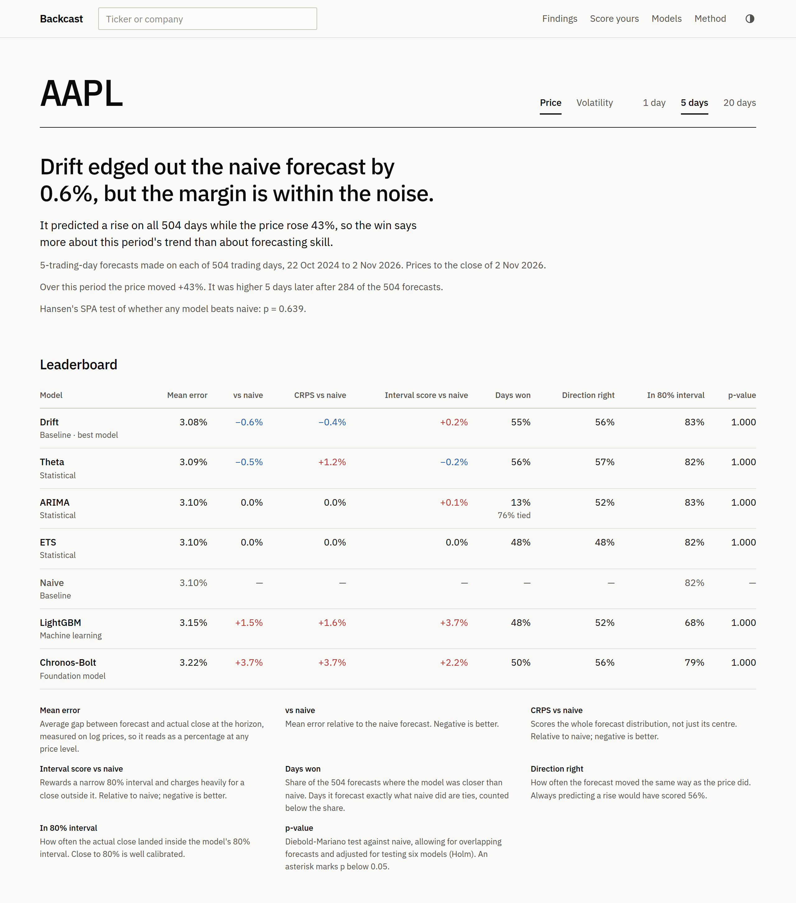
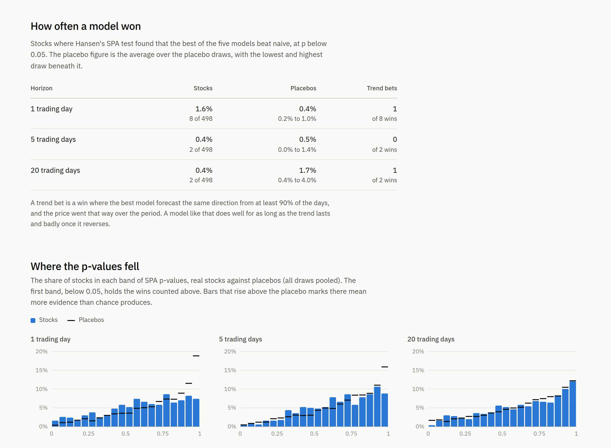
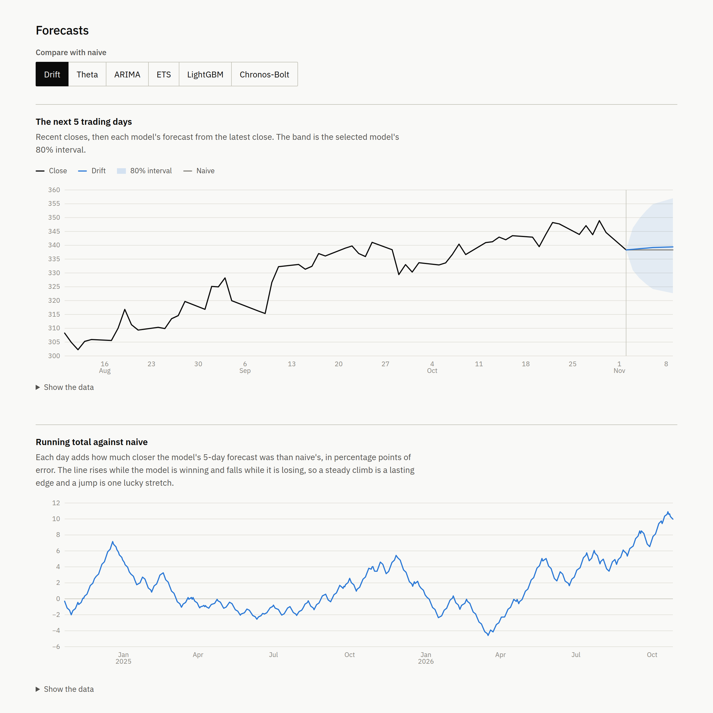
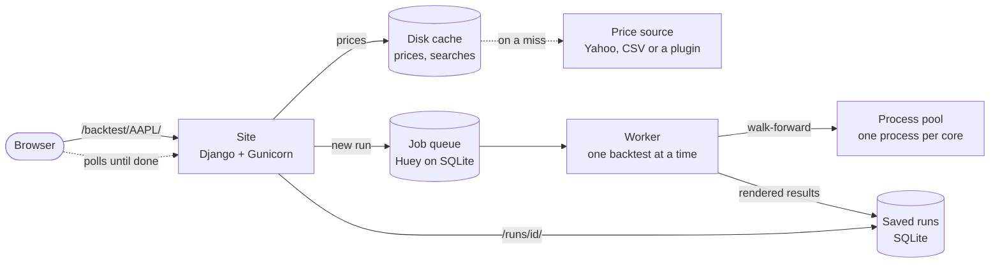

# Backcast

[](https://github.com/adeelbandesha/backcast/actions/workflows/ci.yml)

Backcast checks whether any forecasting model could have predicted a stock's price better than the laziest guess
there is: that the price a few days from now will be the same as it is today.

Most of the time the answer is no. Daily stock prices behave a lot like a random walk, and against a random walk the
naive forecast is very hard to beat. Plenty of stock prediction demos never check this. They draw the model's
predictions over the real price, the two lines look close, and that gets taken as proof the model works. A forecast
that just copies yesterday's price would look every bit as close. Backcast scores each model against that copy,
only on prices the model hadn't seen, and then tests whether the difference is bigger than luck.



## What you can do

| To | Run | More |
|---|---|---|
| Test every model against naive on a stock | `backcast run AAPL --horizon 5` | [Getting started](#getting-started) |
| See the results, charts and the S&P 500 study in a browser | `backcast web` | [The web app](#the-web-app) |
| Test whether models can forecast volatility | `backcast volatility AAPL` | [Volatility](#volatility) |
| Score forecasts you made some other way | `backcast score my_forecasts.csv AAPL` | [Scoring your own forecasts](#scoring-your-own-forecasts) |
| Use your own price files or data provider | `BACKCAST_PRICE_SOURCE=csv BACKCAST_CSV_DIR=~/prices backcast run AAPL` | [Price data](#price-data) |
| Add Amazon's pretrained Chronos-Bolt model | `pip install "backcast[foundation]"` | [Chronos-Bolt](#chronos-bolt) |
| Rerun the S&P 500 study (needs a clone) | `uv run python scripts/study.py run` | [Running the study yourself](#running-the-study-yourself) |

Every command takes `--help`.

## Use it from Python

```python
from backcast import headline, load_prices, run_backtest

prices = load_prices("AAPL")  # five years of daily closes, adjusted for splits
report = run_backtest(prices, horizon=5)  # about 15 seconds on four cores, 45 with Chronos-Bolt
print(headline(report.verdict))
print(report.board)  # the leaderboard, one row per model
```

| Function | What it does |
|---|---|
| `load_prices(symbol)` | Daily closes from the price source, Yahoo unless [you choose another](#price-data) |
| `run_backtest(prices, horizon)` | Backtests every model and tests whether any beats naive. Returns a `Report` |
| `walk_forward(prices, horizon)` | Only the forecasts and their errors, one row per model and date, for your own analysis |
| `score(forecasts, prices, horizon)` | Scores forecasts you made elsewhere: see [Scoring your own forecasts](#scoring-your-own-forecasts) |
| `headline(report.verdict)` | The verdict in one sentence |
| `volatility.run_backtest(prices, horizon)` | The volatility backtest: see [Volatility](#volatility) |

`help(backcast)` lists them, and `help()` on any one explains its arguments and what comes back.

In a script, put these calls under `if __name__ == "__main__":`. The backtest runs in worker processes that import
your script again. Without the guard, Python stops with a RuntimeError about the "bootstrapping phase". A notebook
or the Python prompt doesn't need it.

- [How it works](#how-it-works)
- [What it found](#what-it-found)
- [Limits](#limits)
- [Getting started](#getting-started)
- [The web app](#the-web-app)
- [The models](#the-models)
- [Volatility](#volatility)
- [Scoring your own forecasts](#scoring-your-own-forecasts)
- [Price data](#price-data)
- [How it's built](#how-its-built)
- [Deploying](#deploying)
- [Development](#development)

## How it works

You give it a ticker and a horizon of 1, 5 or 20 trading days. Backcast then:

1. downloads five years of daily closes from Yahoo Finance (or [another source](#price-data)), adjusted for splits
   but not for dividends, and leaves out today's price if the market hasn't closed yet;
2. makes a forecast from every one of the last 504 trading days (about two years), each model seeing only the
   prices up to that day and forecasting the close `h` trading days later. Models are re-estimated every 20 trading
   days and keep their parameters in between, while still seeing each new close;
3. compares each forecast with the price that actually came, on log prices so a 2% miss counts the same at any
   price level, and scores it.

| Column (CLI name)                             | What it measures                                                                         |
| --------------------------------------------- | ---------------------------------------------------------------------------------------- |
| Mean error (`mae_pct`)                        | Average absolute gap between the log forecast and the log close. Reads as a percentage.  |
| vs naive (`relative_mae`)                     | Mean error relative to naive's. The leaderboard is sorted by it, and lower is better.    |
| CRPS vs naive (`relative_crps`)               | Scores the whole forecast distribution (nine quantiles), relative to naive's.            |
| Interval score vs naive (`relative_interval`) | Width of the 80% interval plus a heavy charge for every close outside it, vs naive's.    |
| Days won (`win_rate`, `tie_rate`)             | Share of the 504 forecasts in which the model was closer than naive, and share tied.     |
| Direction right (`direction`)                 | How often the forecast moved the same way as the price. Forecasts of no change left out. |
| In 80% interval (`coverage`)                  | How often the actual close fell inside the model's 80% interval.                         |
| p-value (`p_adjusted`)                        | Diebold-Mariano test against naive, Holm-adjusted for testing five models.               |

Forecasts made a day apart share most of their future, so their errors are correlated and a plain t-test finds
edges that aren't there. In a simulation with no real edge it called 20-day results significant two times out of
three. The Diebold-Mariano test allows for the overlap and was wrong 5 to 7% of the time at the 5% level.

The headline uses a different test. Picking the best of five models and testing it alone overstates the evidence,
so the verdict comes from Hansen's test for superior predictive ability (SPA), which bootstraps all five models
together and asks whether the best of them beats naive by more than luck would. Results are also split by whether
the stock was above or below its 200-day average on the forecast date, and when the best model won by betting the
same direction nearly every day of a period that trended that way, the verdict says so. The Method page in the web
app goes through all of this in more detail.

## What it found

Across the S&P 500, no model beat naive by a margin worth having.

The study ran the same backtest on every current S&P 500 member at all three horizons, on closes up to 23 October
2026, and counted the stocks where Hansen's SPA test found a winner. 498 of the 503 members had enough history. To
see what chance alone produces, each stock was also backtested on placebos: its own daily moves, replayed with
random signs, drawn five times. Any winner found on a placebo is a false positive.

| Horizon | Stocks with a winner | Placebo draws |
| ------- | -------------------: | ------------: |
| 1 day   |           8 of 498   |       1 to 5  |
| 5 days  |           2 of 498   |       0 to 7  |
| 20 days |           2 of 498   |      2 to 20  |

At five and twenty days, the real stocks turned up no more winners than the placebos did. At one day there were
more than luck explains, but the edge is small: 0.1% to 0.5% less error than naive, mostly because a day's move
tends to be partly undone the next day. The median correlation between one day's return and the next was −0.024.



The Findings page in the web app (`/findings/`) has the full results, each model on its own, the stocks where a
model won, and the dataset to download. The member list is today's, taken from Wikipedia (the revision is recorded
in `study.json`). That adds survivorship bias: companies that fell out of the index over the period aren't in it,
and the ones that are did well enough to stay.

### Running the study yourself

Run it from a clean checkout of a single commit, so every row comes from the same code:

```bash
git worktree add --detach ../backcast-study main
cd ../backcast-study && uv sync
uv run python scripts/study.py run --end 2026-10-23
uv run python scripts/study.py export
```

The study is 18 backtests per stock (the real prices and five placebos, at three horizons), about 9,000 in all,
or roughly 100 CPU-hours. That is about a day on four cores, and less in proportion with more. A GPU doesn't
help: the models are statistical fits and a small LightGBM, all on the CPU. Keep the machine from sleeping while
it runs (on Linux, put `systemd-inhibit --what=sleep:idle` in front of the command). Stop it whenever you like
and run the same command again to carry on.

Prices are saved in the work folder the first time they load, so a resumed run and every placebo use exactly the
same data. A download that fails is retried on the next run. `export` refuses rows from more than one version of
the code.

## Limits

Read the results with these in mind:

- Two years is one stretch of market history. A result can hold over these two years and not the next two.
- A stock needs about two and a half years of history before it can be tested: 500 days before the first forecast
  and at least 100 forecasts after it.
- Only the price history goes in. There's no volume, no fundamentals, no news.
- Errors are measured on prices, not on trading returns. A model that beats naive here could still lose money once
  you add costs.
- Dividends aren't added back. On the day a stock goes ex-dividend its price drops by about the dividend, and none
  of the models forecast that.
- Future dates follow the exchange's holiday calendar for most major exchanges. For the rest, they skip weekends
  only.
- By default, prices come through [yfinance](https://github.com/ranaroussi/yfinance), an unofficial Yahoo Finance
  client, and Yahoo's terms apply to the data.

None of this is investment advice.

## Getting started

Backcast needs Python 3.13 and a C++ compiler (see below). To use it:

```bash
pip install backcast
backcast run SPY --horizon 5
```

To change the code, run the tests, rerun the study or build the Docker image, work from a clone instead. You need
[uv](https://docs.astral.sh/uv/), which downloads Python 3.13 if you don't have it:

```bash
git clone https://github.com/adeelbandesha/backcast
cd backcast
uv sync
uv run backcast run SPY --horizon 5
```

The examples in this README are written as `backcast ...`. In a clone, put `uv run` in front, or activate `.venv`
first. If you'd rather use pip in a clone, `requirements.txt` pins the same versions as `uv.lock`:
`pip install -r requirements.txt` and then `pip install -e .`.

You also need a C++ compiler. statsforecast, which supplies ETS, ARIMA and Theta, publishes no wheel for Python
3.13, so uv and pip both build it from source during the install. On Linux that means `g++` (`build-essential` on
Debian and Ubuntu), on macOS the Xcode command line tools (`xcode-select --install`), and on Windows the Microsoft
C++ Build Tools. Without one, the install stops with a build error for statsforecast.

A backtest needs roughly 40 to 80 seconds of CPU time, spread across every core, so a four-core machine finishes
in 10 to 20 seconds. The built-in models all run on the CPU, and a GPU doesn't help them. This is a real run from
23 October 2026:

```
SPY: 5-day forecasts from 504 trading days

Drift edged out the naive forecast by 1.2%, but the margin is within the noise. It predicted a rise on all 504 days while the price rose 30%, so the win says more about this period's trend than about forecasting skill.
SPA p-value that no model beats naive: 0.268

   model  mae_pct  relative_mae  relative_crps  relative_interval  win_rate  tie_rate  p_value  direction  coverage  p_adjusted
   Drift    1.504         0.988          0.995              0.996     0.560     0.000    0.231      0.575     0.895       0.925
   Theta    1.506         0.990          1.005              0.983     0.563     0.000    0.126      0.575     0.889       0.630
   Naive    1.521         1.000          1.000              1.000         —         —        —          —     0.899           —
     ETS    1.522         1.000          1.000              1.001     0.522     0.000    0.383      0.522     0.901       0.925
   ARIMA    1.526         1.003          1.002              1.006     0.131     0.722    0.500      0.515     0.899       0.925
LightGBM    1.549         1.018          0.982              0.906     0.478     0.000    0.276      0.522     0.728       0.925
```

Drift came out on top by predicting a rise on every one of the 504 days while SPY climbed 30%. No model's edge
survives the tests. The best Diebold-Mariano p-value is Theta's 0.126, and that is before adjusting for five tries.
If none of the models were better than naive, a best result this good would still turn up about 27% of the time
(the SPA p-value). ARIMA tied naive on 72% of days: it usually settles on a random walk.

The intervals are worth a look too. Most models' 80% intervals held the actual close about 90% of the time, so
they were too wide. Daily returns have fat tails: a few very large days inflate the volatility the intervals are
built from, which leaves them wider than a typical week needs. LightGBM's quantile regression has the opposite
problem at 73%, yet it has the best interval score: its narrower intervals saved more than its extra misses cost.

## The web app

```bash
backcast web
```

This starts the site and a worker beside it. Open http://127.0.0.1:8000 and search for a company or ticker. The
backtest runs in the worker while the page shows where it is in the queue, and the results appear when it's done.

Every finished run is saved and has its own address, `/runs/<id>/`, which keeps showing that run. The id is a
fingerprint of the prices, the settings and the Backcast version, so asking for the same backtest on the same data
goes straight to the saved run, and new prices make a new one. The page records the date of the last close, the
price source, the version and the settings it ran with.

Each backtest page has the verdict, the leaderboard, the same comparison split into up and down markets, a chart
of the next few trading days as each model sees them, and a running total of how far the chosen model has pulled
ahead of naive, or fallen behind, over the two years. Every chart has a table of the numbers behind it.



## The models

| Model        | Kind             | Notes                                                                                          |
| ------------ | ---------------- | ---------------------------------------------------------------------------------------------- |
| Naive        | Baseline         | Tomorrow's price is today's. The benchmark.                                                    |
| Drift        | Baseline         | Naive plus the average daily percentage change over the training data.                         |
| ETS          | Statistical      | Exponential smoothing, components picked automatically.                                        |
| ARIMA        | Statistical      | Auto-ARIMA.                                                                                    |
| Theta        | Statistical      | The Theta method, which did well in the M3 competition.                                        |
| LightGBM     | Machine learning | Gradient-boosted trees on the last 20 daily log returns, quantile regression for the interval. |
| Chronos-Bolt | Foundation model | Optional. A pretrained transformer that forecasts without being fitted to the stock.           |

ETS, ARIMA and Theta come from [statsforecast](https://github.com/Nixtla/statsforecast). Every model is fitted to
log prices and its forecasts converted back, so none can forecast a price below zero, and each one's point forecast
is the median of its distribution.

### Chronos-Bolt

[Chronos-Bolt](https://github.com/amazon-science/chronos-forecasting) is Amazon's pretrained forecasting model. It
learned from a large collection of time series and forecasts a new one without being fitted to it. It needs
PyTorch, so it is an optional extra:

```bash
pip install "backcast[foundation]"        # in a clone: uv sync --extra foundation
```

uv installs the CPU build of PyTorch, about 800 MB on disk, rather than the default Linux build, which adds several
GB of CUDA libraries. pip takes PyTorch from PyPI, CUDA and all, unless you install the CPU build first:
`pip install torch --index-url https://download.pytorch.org/whl/cpu`. Chronos-Bolt runs on an
NVIDIA GPU if PyTorch was built with CUDA and finds one, on the GPU of an Apple silicon Mac, and on the CPU otherwise.
With uv, an NVIDIA GPU needs the CUDA build installed over the CPU one, from PyTorch's index for your CUDA version
(see pytorch.org): `uv pip install torch --index-url <that index>`. A later `uv sync` puts the CPU build back. With
the extra installed, Chronos-Bolt joins every backtest.

The first run downloads its weights (180 MB) from Hugging Face. Backcast uses the small version, with 48M
parameters. It takes about 95 ms per forecast on one core, so a backtest takes about three times as long: 47
seconds instead of 15 on a four-core laptop.

It sees log prices, like the other models. On four stocks it was tried with both: raw prices did slightly better
on AAPL and NVDA, but on PTON, which lost most of its value, raw prices left it 30% worse than naive at one day
against 8% with log prices. It usually doesn't beat naive on price. On AAPL at five days it came last, 3.7% worse
than naive.

To add a model, subclass `Model` in `src/backcast/models.py`, implement `forecast(y, h)` so it returns a `Forecast`
with a median path of length `h` and its quantiles from 10% to 90% (an array of shape `(9, h)`), and append an
instance to `MODELS`. Forecasts must be positive prices with the quantiles in increasing order, or the backtest
stops with an error; the built-in models work on log prices, which guarantees both. If estimating is slow,
implement `fit(y, h)` instead: it returns a function that forecasts from any later history with the same
estimates, and the backtest calls it between refits. The CLI, the leaderboard and the charts will include it.
Forecasts run in worker processes, so the model has to be picklable. Defining the class at module level is
enough.

## Volatility

The size of a stock's moves is far more predictable than their direction. Big moves come in clusters, and over
months volatility drifts back to its usual level. A second backtest asks whether models can forecast it:

```bash
backcast volatility SPY --horizon 5
```

In the web app it's the Volatility tab on any backtest page. The schedule is the same as for prices: a forecast
from each of the last 504 trading days, models re-estimated every 20. Each model forecasts the variance of the
return over the next `h` trading days, and it is scored against the realized variance, the sum of the squared
daily log returns over those days, with the QLIKE loss. QLIKE ranks forecasts correctly even though one day's
squared return is a very noisy measure of its variance (Patton, 2011), it depends only on the ratio of realized to
forecast so a few violent days don't decide the result, and it charges more for too little volatility than too much.

| Model            | Kind       | Notes                                                                        |
| ---------------- | ---------- | ---------------------------------------------------------------------------- |
| Naive            | Baseline   | The last 20 trading days' volatility carries on. The benchmark.              |
| Long-run average | Baseline   | The average over all the history so far. Often harder to beat than naive.    |
| EWMA             | Smoothing  | RiskMetrics' exponentially weighted average of squared returns, decay 0.94.  |
| GARCH(1,1)       | GARCH      | Fitted by maximum likelihood with [arch](https://github.com/bashtage/arch).  |
| GJR-GARCH        | GARCH      | GARCH with an extra term for falls, which raise volatility more than rises.  |
| HAR              | Regression | Corsi's regression on the last day's, week's and month's squared returns.    |

The verdict runs Hansen's SPA test twice: can any model beat naive, and can any beat the long-run average? The
second matters because a model can beat naive just by averaging more days than naive's month.

`scripts/volatility_check.py` ran it on the 498 stocks of the S&P 500 study, and again on each stock's returns in
shuffled order, which keeps every move but breaks up the calm and volatile stretches. These are the shares of stocks
where some model won by more than luck (SPA p < 0.05):

| Some model beat           | 1 day | 5 days | 20 days |
| ------------------------- | ----: | -----: | ------: |
| naive, real returns       | 38.2% |  45.0% |   56.4% |
| naive, shuffled           | 75.3% |  80.3% |   83.9% |
| long-run, real returns    |  4.4% |   3.2% |    4.4% |
| long-run, shuffled        |  0.0% |   0.4% |    2.2% |

Beating naive is easier on the shuffled returns, because without clusters a month of returns is just a noisier
average. Against the long-run average the models win a little more often than on the control, but no more often
than a 5% test flags by chance. Volatility clustering is there, but with daily closes over two years, following it
rarely beats the plain average on a single stock. The studies that find a clear edge measure each day's volatility
from intraday prices.

## Scoring your own forecasts

If you made forecasts some other way, Backcast can score them against naive with the same metrics and tests. Put
one forecast per row in a table: `date` is the trading day whose close you forecast from, and `forecast` is the
price you expected `horizon` trading days later. From the command line:

```bash
backcast score my_forecasts.csv AAPL --horizon 5
```

That prints the same verdict and table as `backcast run`, with your forecasts and naive as the only two rows. In
Python:

```python
import pandas as pd

from backcast import headline, load_prices, score

forecasts = pd.read_csv("my_forecasts.csv")  # columns: date, forecast, and optionally q10 ... q90
report = score(forecasts, load_prices("AAPL"), horizon=5)
print(headline(report.verdict))
print(report.board)
```

The forecast is scored as a median, on log prices, like the built-in models. Add `q10` and `q90` columns for an 80%
interval, which gives coverage and the interval score. With all nine quantiles, `q10`, `q20` and so on up to `q90`,
CRPS is scored too. Naive is forecast from each of your dates, so both are scored on the same days.

You need at least 100 forecasts whose target date has passed. Forecasts whose target is still in the future are
left out. The price history has to start at least 200 trading days before your first forecast so the up and down
market split can be worked out. A date that isn't a trading day, two forecasts from one day, or a price or quantile
that is zero, negative or out of order is refused with a message that says which.

Backcast can check the dates, but it can't tell whether a forecast used prices from after its date. That part is up
to you.

The web app does the same at `/score/` ("Score yours" in the menu): pick the stock and horizon and upload the CSV.
The results page is the backtest's, without the forecast of the next few days. Uploads aren't saved, so unlike a
backtest the results have no permalink.

## Price data

Prices come from Yahoo Finance by default, with no account or key needed. `BACKCAST_PRICE_SOURCE` switches the
command line and the web app to another source, named or given as a module path:

```bash
BACKCAST_PRICE_SOURCE=csv BACKCAST_CSV_DIR=~/prices backcast run AAPL
BACKCAST_PRICE_SOURCE=mysources.feed backcast web
```

Backcast ships two sources, `yahoo` and `csv`, and doesn't include any paid data provider. If you have a licence for
one, you can add it yourself (see below), either as a module or as a package that anyone can install.

**CSV files.** One file per symbol, named after it (`AAPL.csv`), with a `Date` and a `Close` column. Other columns are
ignored, so a standard export works as it is. Use closes adjusted for splits but not for dividends, and never an
Adj Close column. Set `BACKCAST_CSV_CALENDAR` to an
[exchange_calendars](https://github.com/gerrymanoim/exchange_calendars) code such as `XNYS` and future dates skip
that exchange's holidays; otherwise they skip weekends only.

**Your own provider.** Any importable module that defines `load_prices(symbol, years)`, returning a pandas Series of
closes indexed by date, split-adjusted and not dividend-adjusted, finished trading days only. Set
`close.attrs["calendar"]` if you know the exchange. Raise `backcast.data.DataError` with a readable message when a
symbol can't be loaded. Two optional names: `search_symbols(query, limit)`, returning dicts with `symbol`, `name` and
`exchange` for the web app's search box, and `ATTRIBUTION`, a sentence for the footer.

**A provider package.** To share a source, or keep several installed side by side, put the module in its own
package and register it under the `backcast.price_sources` entry point group. Backcast registers `yahoo` and `csv`
the same way. In the package's `pyproject.toml`:

```toml
[project.entry-points."backcast.price_sources"]
polygon = "backcast_polygon.source"
```

After `pip install backcast-polygon`, `BACKCAST_PRICE_SOURCE=polygon` selects it. Read API keys from environment
variables in your module, never from Backcast's settings. Saved runs record the source's name, so results from
different providers never mix.

Whatever the source, Backcast checks the prices before a backtest sees them: one positive close per date, sorted,
trimmed to the same five years. Problems are reported with the date they occur on. A source that can't be imported
stops the command line with an explanation and stops the web app at startup.

## How it's built



A backtest request loads the prices (from the disk cache if they're less than an hour old), fingerprints them
together with the settings and the code version, and looks for a saved run with that fingerprint. If there is one,
the browser goes straight to it. If not, the site queues a new run and sends the browser to the run's page, which
polls until the worker has finished.

The worker runs one backtest at a time, because each one already keeps every core busy: the forecast origins are
split into blocks and the blocks are spread over a process pool. When a run finishes, the worker saves the rendered
results, not just the numbers, so a run's page keeps looking the way it did even after the templates change. The
command line uses the same engine without any of this, and scoring an upload is fast enough (about 0.2 seconds) to
run inside the request.

There is no Redis and no database server. The queue and the saved runs are two SQLite files, which is plenty for a
single machine running one job at a time.

### Decisions and the evidence for them

Most of these were settled by an experiment rather than by preference. Where a script is named, it re-runs that
experiment.

| Decision | Instead of | Why |
| --- | --- | --- |
| A forecast from every trading day for two years (504 origins) | 30 non-overlapping windows | Moving the 30 windows by one day turned AAPL from a significant result into noise. 30 is too few. |
| Re-estimate the models every 20 trading days | Every day | Daily refits moved each model's error relative to naive by 0.2 points on average and 1.3 at most, changed no verdict, and took 17 times as long (`scripts/refit_check.py`). |
| Fit and score on log prices | Raw prices | On raw prices, the intervals for BYND, which lost most of its value, went below zero on all 504 days. Log prices keep every forecast positive, and the point forecast becomes the median. |
| Diebold-Mariano with equal weights and the Harvey-Leybourne-Newbold correction | Newey-West weights | Simulated with no real edge, it called 5 to 7% of results significant at the 5% level. Newey-West called 10 to 11%, and a plain t-test called 20-day results significant two times in three. |
| Hansen's SPA test for the headline | Testing the best model on its own | The best of several models is the one most likely to have been lucky. SPA allows for the search. |
| Five placebo draws in the study | One | Each placebo day's sign is shared by every stock, so the market keeps moving together, but that makes one draw a single random market path. Five show how much chance varies. |
| Closes adjusted for splits, not dividends | Yahoo's adjusted close | Dividend adjustment rewrites every earlier price each time a dividend is paid. Checked against NVDA's 2024 split and a KO ex-dividend day. |
| Judge volatility models against the long-run average as well as naive | Naive only | On shuffled returns, with no clustering to find, the models still beat naive on 75 to 84% of stocks (`scripts/volatility_check.py`). |
| Huey and SQLite | Celery, Redis and a database server | One machine, one job at a time. Two files to back up, nothing else to run. |
| Run ids that hash the prices, settings and code version | Random ids | The same inputs always reach the same saved run, and a link always shows what it showed. New prices make a new run. |
| A `forkserver` process pool | The default `fork` | Forked workers deadlocked on OpenMP state left over from the parent process. |
| Uploaded forecasts are scored and thrown away | Saving them like a run | Scoring takes a fraction of a second, and people's forecasts have no reason to stay on a server. |

### Project layout

```
src/backcast/
  data.py        loads and checks prices from the configured source; trading calendars
  sources/       the built-in price sources: Yahoo Finance and CSV files
  models.py      the forecasting models
  evaluate.py    walk-forward backtest, metrics, significance tests, the verdict, scoring uploads
  volatility.py  the volatility models, their backtest and verdict
  study.py       the S&P 500 study's placebo and dataset rows
  version.py     the version recorded with every run
  cli.py         the backcast command
  web/           Django app: views, templates, CSS, and the charts (Observable Plot)
    tasks.py     the background jobs: running and saving a backtest, and the nightly examples
    models.py    the saved run
tests/           engine, data, price source, study, view and browser tests; none of them touch the network
scripts/         refit_check.py, the experiment behind the refit interval; study.py, the S&P 500 study;
                 volatility_check.py, the volatility backtest across the study's stocks
```

## Deploying

The web app is a small Django project with no user accounts. It needs two processes: the site, run with Gunicorn,
and a worker that runs the backtests.

The simplest way to run both is Docker Compose, which also keeps the saved runs in a Docker volume:

```bash
BACKCAST_COMMIT=$(git describe --always --dirty) docker compose up --build
```

The site is then at http://127.0.0.1:8000, reachable only from this machine. The image refuses to build without
`BACKCAST_COMMIT`, for the reason given below. A one-off `migrate` service sets up the database before the site and
the worker start, so they never both try. To use another price source, set `BACKCAST_PRICE_SOURCE` the same way; a
provider package has to be installed in the image first.

Without Docker:

```bash
export BACKCAST_SECRET_KEY=... BACKCAST_ALLOWED_HOSTS=backcast.example.com BACKCAST_DATA_DIR=/var/lib/backcast
uv run backcast worker &      # creates or updates the database, then waits for jobs
uv run gunicorn --timeout 120 backcast.web.wsgi
```

The job queue is [Huey](https://huey.readthedocs.io/) on a SQLite file, and saved runs are in a second SQLite file,
so there's no Redis or database server to run. Both live in `BACKCAST_DATA_DIR`, which the site and the worker must
share and which should be backed up if you want old run links to keep working.

Settings come from environment variables:

| Variable                    | Default                          | What it's for                                            |
| --------------------------- | -------------------------------- | -------------------------------------------------------- |
| `BACKCAST_SECRET_KEY`       | an insecure development key      | Django's secret key. Set it in production.               |
| `BACKCAST_ALLOWED_HOSTS`    | `localhost,127.0.0.1`            | Comma-separated host names.                              |
| `BACKCAST_DEBUG`            | off                              | Set to `1` for Django's debug pages.                     |
| `BACKCAST_DATA_DIR`         | `~/.backcast`                    | Saved runs and the job queue (two SQLite files).         |
| `BACKCAST_CACHE_DIR`        | `backcast-cache` in the temp dir | Where prices, searches and rate limits are cached.       |
| `BACKCAST_COMMIT`           | from git, in a source checkout   | The commit to record with each run. Set it in an image.  |
| `BACKCAST_STATIC_ROOT`      | unset                            | Only needed if you run `collectstatic`.                  |
| `BACKCAST_RUNS_PER_HOUR`    | `30`                             | New backtests one visitor may start per hour.            |
| `BACKCAST_CLIENT_IP_HEADER` | unset                            | Header your reverse proxy puts the visitor's address in. |
| `BACKCAST_LOG_LEVEL`        | `INFO`                           |                                                          |
| `BACKCAST_PRICE_SOURCE`     | `yahoo`                          | `yahoo`, `csv`, or your own module. See Price data.      |
| `BACKCAST_CSV_DIR`          | unset                            | The folder of price files for the `csv` source.          |
| `BACKCAST_CSV_CALENDAR`     | unset                            | Trading calendar for CSV prices, such as `XNYS`.         |

The backtest page loads prices inside the request, and when Yahoo is slow that can take most of a minute, so
the example raises Gunicorn's 30-second timeout. Prices are cached on disk for an hour, and every Gunicorn worker
reads the same cache. WhiteNoise serves the static files directly from the package, so `collectstatic` is
optional.

The worker runs one backtest at a time, because each one already spreads across every core. Others wait in the
queue. Runs the site finds already saved cost nothing. A run left unfinished for 15 minutes, say because the worker
restarted, is started again the next time someone asks for it.

The version recorded with each run, and used in its id, is the package version plus the git commit when Backcast
runs from a checkout. Outside a checkout, such as in a container image, set `BACKCAST_COMMIT`; otherwise a new
release of the code with the same version number would find the old saved runs and show them.

Every weekday at 22:30 UTC, after the US close, the worker runs the six examples on the home page (AAPL, MSFT,
NVDA, SPY, KO and TSLA) at all three horizons, so they open straight away.

Because a new run keeps every core busy, each visitor can start only a limited number per hour; saved runs don't
count. Behind a reverse proxy, set `BACKCAST_CLIENT_IP_HEADER` (for example `X-Forwarded-For`), or
every visitor appears to come from the proxy and they all share one limit. Only set it if the proxy overwrites
that header, since anyone can send it.

## Development

```bash
uv run pytest
uv run ruff check .
uv run ruff format --check .
```

`scripts/refit_check.py` re-runs the experiment behind the refit interval: it backtests AAPL, KO and NVDA with models
re-estimated every day, every 5 days and every 20, and reports how far the results move. It needs about two
CPU-hours, so half an hour on four cores.

CI runs the same three commands on every pull request. It also checks the JavaScript for syntax errors, runs
Django's system checks, builds the wheel to make sure the templates and static files are still packaged, and
makes sure `requirements.txt` still matches `uv.lock`.

The tests use synthetic price series and never touch the network. They cover the walk-forward split (including
models that report how many prices they were shown and fitted on, to catch any leakage), the refit schedule, the
metric arithmetic, the false-positive rate of the Diebold-Mariano test on overlapping forecasts, the trading
calendars, the price source checks and the CSV source, the study's placebo, and the views and background jobs with
the price download mocked out. They run the jobs inside the request (Huey's immediate mode) and keep their SQLite
files in a temporary folder.

`tests/test_browser.py` drives a real browser with Playwright to test the JavaScript: the charts, the model picker,
the theme toggle redrawing them, a run page picking up its results, the upload form, symbol search, and that no page
scrolls sideways on a phone. It uses your installed Google Chrome, so there's no browser to download, but Chrome
has to be installed. Any error in the browser console fails the test.

The backtest pool uses the `forkserver` start method, because forked workers deadlocked on OpenMP state left over
from the parent. As a result, a script that calls `walk_forward` has to live in a real file and keep its top-level
code under `if __name__ == "__main__":`. Piping it into `python -` won't work.

## Contributing

Fixes and new models are welcome.
[CONTRIBUTING.md](https://github.com/adeelbandesha/backcast/blob/main/CONTRIBUTING.md) covers setup, the checks CI
runs, and what a new model has to guarantee. Please report security problems privately, as described in
[SECURITY.md](https://github.com/adeelbandesha/backcast/blob/main/SECURITY.md).

## License

MIT. See [LICENSE](https://github.com/adeelbandesha/backcast/blob/main/LICENSE).

The web app bundles a few things written by other people. [D3](https://d3js.org) and
[Observable Plot](https://observablehq.com/plot/) are under the ISC license. The IBM Plex fonts are under the SIL Open
Font License, and a copy of it sits next to the font files.
